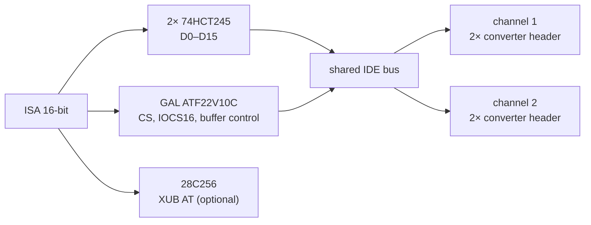

# isa16_ssd_controller – Concept (16-Bit ISA SSD-Controller)

Status: **concept 0.1 (2026-10-25)**. Nothing has been drawn, built or tested.
Everything marked *assumption* is open until Stefan confirms it.

Requested by Stefan on 2026-10-25 as the 16-bit sibling of
[isa8_ssd_controller](https://github.com/sfambach/8-Bit-ISA-SSD-Controller).

## 1. Goal

A 16-bit ISA card (286 to 486) with **SATA ports for SSDs**. Technically it is a
**standard AT IDE controller**: the mainboard BIOS, the XT-IDE Universal BIOS AT
build (XUB) and every standard DOS/Windows driver see plain IDE disks and CD-ROMs.

### 1.1 Why a separate 16-bit card

| | 8-bit card (isa8) | 16-bit card (isa16) |
|---|---|---|
| Machines | XT, 286+ | 286+ only |
| Register layout | XT-IDE (300h, latch) | standard AT IDE (1F0h/170h) |
| Data path | 8 bits + latch | 16 bits, IOCS16 |
| Speed | slow | several times faster (not measured) |
| BIOS | XUB required | mainboard BIOS, XUB optional |
| CD-ROM | needs own driver (later) | standard ATAPI drivers |

A combined 8/16-bit card is not planned: a 16-bit edge does not fit many XT slots
(components behind the slot), and the 8-bit card already runs in 16-bit slots.

### 1.2 Requirements for the SSDs

Same as isa8_ssd_controller §1.1: SATA I capable (JM20330 is SATA 1.0),
classic ATA PIO commands, small sizes are fine (DOS without INT 13h extensions
~8 GB, FAT16 max 2 GB). Mainboard BIOSes before ~1994 see max 504 MB without
LBA – the XUB AT build in the optional ROM fixes that.

## 2. Block diagram

- Two 74HCT245 buffer D0–D7 and SD8–SD15; no latches.
- GAL decodes CS0 (base+0..7) and CS1 (base+206h/207h, e.g. 3F6h/3F7h) per
  channel, drives **IOCS16** (open collector via 74LS07 or similar) for data
  register accesses, and controls the buffers.
- Second GAL for the ROM select, if the inputs of one do not suffice
  (*assumption*, as on the 8-bit card).
- IRQ 14 / 15 via jumper and a tri-state driver; no DMA (PIO only).
- Converter headers, power and PTC exactly as on the 8-bit card.

## 3. Address map (proposal)

| Function | Base | IRQ | Setting |
|---|---|---|---|
| Channel 1 | 1F0h/3F6h (primary) or 1E8h/3EEh (tertiary) | 14 / 11 | DIP: off/primary/secondary/tertiary/quaternary |
| Channel 2 | 170h/376h (secondary) or 168h/36Eh (quaternary) | 15 / 10 | DIP as above |
| Option ROM | D0000h | – | DIP: off/C8000h/D0000h/D8000h/E0000h |

- Primary/secondary for 286/386 boards without on-board IDE: the mainboard BIOS
  finds the drives itself.
- Tertiary/quaternary for 486 boards whose on-board IDE stays active: then XUB
  in the card ROM is required.
- *Assumption:* 1E8h/168h and IRQ 11/10 as the usual tertiary/quaternary values.

## 4. Extensions for later versions

1. Setup menu in ROM (shared idea with isa8_ssd_controller §8.4).
2. Bridge chips on the card instead of plug-on converters.

## 5. Licences

- Hardware: CERN-OHL-S-2.0.
- XT-IDE Universal BIOS: GPL-2, not included.
- Documentation: CC BY-SA 4.0.

## 6. Open points

1. Repo `sfambach/16-Bit-ISA-SSD-Controller` – Stefan creates it (2026-10-25).
2. One or two GALs.
3. Test SATA SSD + converter on an existing 16-bit IDE port first.

## 7. Steps

1. Test: converter + SATA SSD on an on-board IDE port of a 386/486.
2. KiCad schematic + PCB (JLCPCB), ISA bracket by OpenSCAD.
